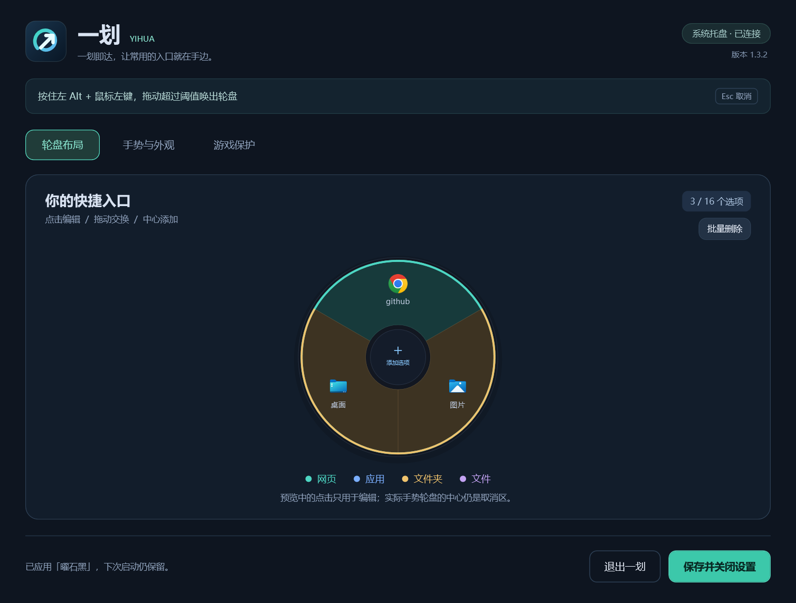
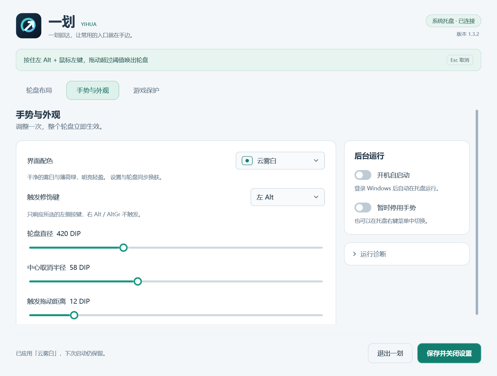
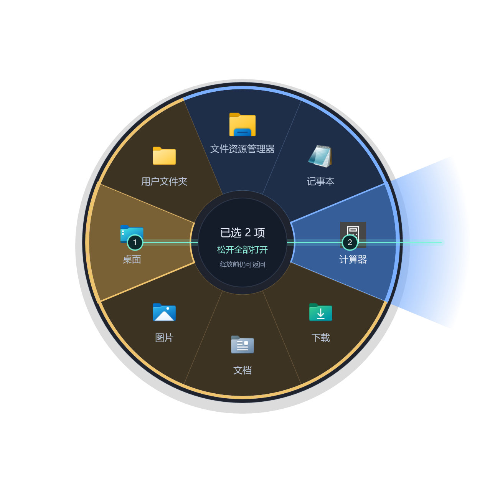

# 一划 · YIHUA

一划即达，让常用的入口就在手边。

Windows 托盘轮盘快捷启动器，使用 C#、.NET 10、WPF 与 Win32 输入钩子。支持 Windows 10 / 11 x64，自包含便携版无需安装 .NET，不显示控制台窗口。

## 界面预览

| 轮盘布局 · 曜石黑 | 手势与外观 · 云雾白 |
| --- | --- |
|  |  |

选择多个入口后，从最后一项继续向外拉，刚超出轮盘外沿即可确认；整片方向范围都有效，松开左键后一起打开，无需瞄准按钮。



以上图片由程序实际 WPF 界面与绘制组件导出，手势画面使用示例入口。

## 使用

完整解压便携版 ZIP，保留所有依赖文件，运行「一划.exe」。首次启动打开设置，以后在系统托盘后台运行。再次启动程序会打开已有实例的设置。

1. 按住左 Alt，再按住鼠标左键拖动，超过阈值唤出轮盘。
2. 在选项上停留约 0.15 秒，将入口加入本次选择；可继续选择其它入口。编号和路径线显示选择顺序，同一入口只计一次。
3. 从最后选项继续往外拉，进入渐变确认区，中心出现「松开全部打开」后松开左键，按顺序启动全部入口。
4. 在圈内或中心松开、从未选择的方向直接出圈、提前松开修饰键或按 Esc，整次取消，不提前启动任何入口。

只响应左侧修饰键，右 Alt / AltGr 不触发；可改成左 Ctrl 或左 Shift。

轮盘中心固定在鼠标按下的触发点。靠近任务栏或屏幕边缘时不再自动移动中心，超出屏幕的部分自然裁切。确认方向只保留柔和渐变提示，没有虚线范围边框或独立确认按钮；圈内松开及其它取消方式保持不变。

## 设置

- **轮盘布局**：点击扇区编辑，中心加号添加，拖动到另一个选项交换位置。「批量删除」可勾选多个入口统一删除配置，目标文件不受影响。单层支持 1–16 个入口。
- **手势与外观**：调整大小、取消半径和拖动阈值；支持曜石黑、云雾白、午夜蓝、暖砂四套配色。设置、详情和实际轮盘同步换肤，选择自动保存。
- **游戏保护**：双击左侧运行程序移入右侧名单，按前台 exe 名称停用手势，窗口模式也有效。预置 LOL 相关进程，可额外启用全屏保护。

支持应用、快捷方式、文件、文件夹、http/https 网址、参数和工作目录。按目标类型配色并提取系统图标。

添加或编辑选项时，点击「运行中的程序」，可查看已打开应用的图标、名称、窗口标题和完整路径，支持搜索、刷新和双击选择。选中后自动填入程序路径与工作目录，名称留空时自动填写；已有自定义名称保留。更换程序会清空旧启动参数，保存选项后才加入轮盘。列表只显示可读取路径的应用窗口；同一程序的多个窗口合并，不复制当前文档或进程启动参数。

「保存并关闭设置」后继续后台运行；托盘右键可暂停手势、切换自启动或退出。退出会释放输入钩子。

配置优先保存在便携目录的 `Data/settings.json`，目录不可写时回退至当前用户的 `LocalApplicationData/OrbitLauncher`。分发 ZIP 不包含个人配置；迁移时可另外复制 Data 文件夹，新电脑上的应用路径需要有效。

## 构建

开发环境：Windows x64、.NET 10 SDK、PowerShell 7。

```powershell
./build.ps1
# 也可以指定 SDK
./build.ps1 -Dotnet 'D:/SDK/dotnet.exe'
```

默认优先使用项目内 `.tools/dotnet/dotnet.exe`，不存在时使用 PATH 中的 SDK。输出为 `deliverables/一划便携版/一划.exe`，已有 Data 配置保留。

构建缓存和可配置临时目录位于 work/；发布暂存成功后自动清理，失败时保留，也可使用 `-KeepStage` 保留排查。项目内已有的 `.tools/packages` 可作为依赖回退缓存。构建脚本拒绝将缓存根目录放到 C 盘。

## 验证与打包

```powershell
. ./src/BuildEnvironment.ps1
New-Item -ItemType Directory -Path verification -Force | Out-Null
Start-Process './deliverables/一划便携版/一划.exe' -ArgumentList '--self-test', "$PWD/verification/self-test.json" -Wait
```

WinExe 不显示控制台，运行完毕后读取 JSON。`--self-test` 验证配置、状态机、方向、主题和绘制像素。`--verify-ui` / `--verify-hold` 验证 WPF 与内部输入流程，需在没有其它实例、可使用交互桌面的环境中执行；不会合成实体鼠标输入。报告路径需为绝对路径。

`src/Package.ps1` 自动读取源码版本，要求 `verification/final-版本-self-test.json`、`final-版本-verify-ui.json`、`final-版本-verify-hold.json` 均成功后，生成便携版与精简源码 ZIP，并逐文件校验。源码包只含与仓库相同的源码、文档和脚本。

GitHub 工作流使用官方 [checkout](https://github.com/actions/checkout) 与 [setup-dotnet](https://github.com/actions/setup-dotnet)，执行 Windows 构建与基础检查。桌面集成检查留在本地交互环境执行。

## 源码

- `Models.cs` / `GestureSelection.cs`：配置、方向数学、输入状态机、多选和外部确认。
- `InputHooks.cs` / `ModifierState.cs`：独立输入线程及左右修饰键处理。
- `RadialWindow.cs`：轮盘、编辑预览、路径、渐变确认区与绘制缓存。
- `Themes.cs` / `Controls.xaml` / `ItemAppearance.cs`：主题、共享控件与类别配色。
- `SettingsWindow.*` / `ItemEditorWindow.*` / `RunningApplicationsWindow.*`：设置、详情编辑及运行程序选择。
- `ForegroundGuard.cs` / `Services.cs` / `TrayIcon.cs`：应用保护、目标启动、图标、自启动和原生托盘。
- `SelfTests*.cs`：基础、界面、手势与绘制验证。

内部程序集、配置兼容标识和自启动注册表值仍使用 OrbitLauncher。SDK、缓存、便携程序、个人配置及原始验证报告与截图由 .gitignore 排除；公开展示图片位于 `docs/screenshots/`。

尚未完整实测 LOL 对局、多显示器混合 DPI、Windows 10 实机、重新登录自启动，以及所有物理输入释放和点击穿透组合；内部检查不等同于这些实机验证。
